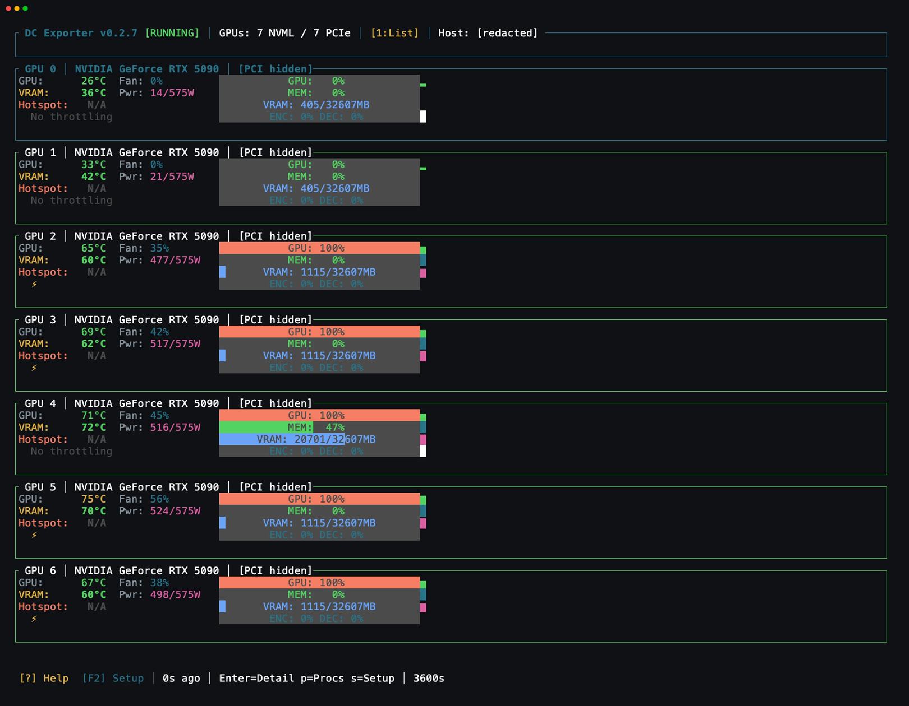
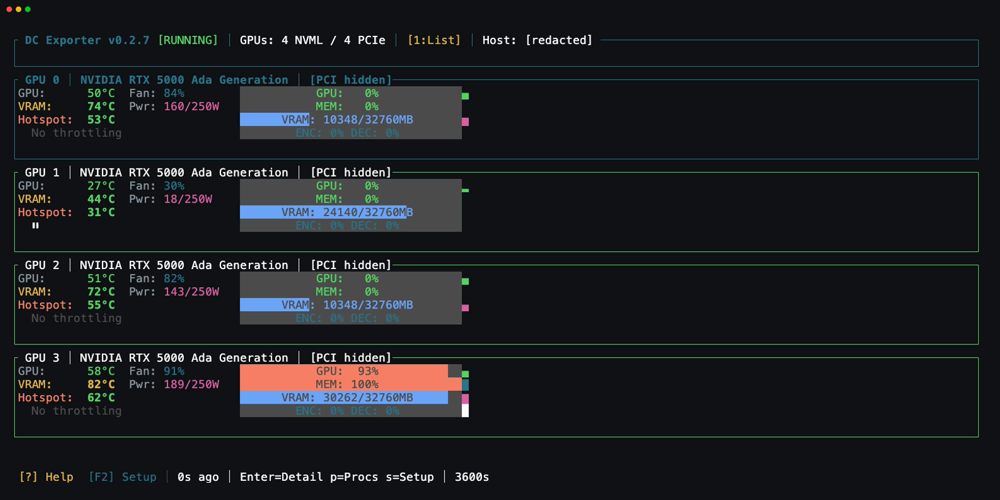

# CryptoLabs DC Exporter

GPU telemetry and diagnostics for Prometheus, built by [CryptoLabs](https://www.cryptolabs.co.za/).
DC Exporter runs on Linux and combines NVIDIA metrics, memory and hotspot
temperatures where available, PCIe errors, recovery diagnostics and VM passthrough
state. Use its HTTP endpoint for monitoring, one-shot mode for inspection, or the
interactive terminal UI for a live view of your GPUs.

Need help investigating a GPU server failure? [CryptoLabs AI SRE](https://www.cryptolabs.co.za/services/)
collects diagnostic evidence and proposes a fix plan for operator review.
DC Exporter reports observations; it does not reset GPUs, reboot hosts or change
workloads.

## Quickstart

This README describes the current development source; experimental RTX 5090
telemetry and current recovery diagnostics require a matching development or
source build. Historical stable **0.2.8** downloads retain older provenance and
were not built from this source history.

Download the Linux x86-64 executable `dc-exporter-rs` and matching checksums from
[releases](https://github.com/cryptolabsza/dc-exporter-releases/releases).
Verify its SHA-256 against that release's `SHA256SUMS`, then run it on a system
with an installed NVIDIA driver and appropriate device permissions:

```sh
chmod +x dc-exporter-rs
./dc-exporter-rs --no-register-access --port 9835
```

From another terminal:

```sh
curl http://localhost:9835/metrics
```

The default collection interval is 10 seconds and the HTTP listener binds all
interfaces on port **9835**. Restrict access to trusted monitoring systems through
your host's network policy. `--no-register-access` disables direct BAR register
reads while preserving NVML telemetry and explicitly selected RUSD collection.
For VM hosts, read the [guest-probing limits](#vm-passthrough) before collecting.

For Prometheus running on the same host:

```yaml
scrape_configs:
  - job_name: dc-exporter
    static_configs:
      - targets: ["localhost:9835"]
```

## Terminal UI and one-shot mode

```sh
./dc-exporter-rs --no-register-access --tui
./dc-exporter-rs --no-register-access --one-shot
./dc-exporter-rs --help
```

The TUI shows GPU utilization, memory use, power, temperatures and health. Use
arrows or Tab to select a GPU, Enter for details, Space to pause, `?` for help
and `q` to quit. Memory temperature and memory utilization are separate readings;
the thermal detail view includes the memory backend and status.

### TUI captures

The following captures show deployed **0.2.7** on **17 October 2026**, with
identifiers redacted. They show observed memory-temperature output; they are
neither captures of the new CI build nor hardware-qualification results.



RTX 5090: experimental memory-temperature telemetry in the TUI list view.



RTX 5000 Ada: memory-temperature telemetry in the TUI list view.

## Install as a service

The DEB package is `dc-exporter-rs`; its executable is
`/usr/local/bin/dc-exporter-rs` and its service is `dc-exporter.service`.
Download and verify the matching DEB before installation. Review the
[service definition](systemd/dc-exporter.service): it runs as root and permits
legacy register access by default.

```sh
sudo dpkg -i dc-exporter-rs_amd64.deb
sudo systemctl daemon-reload
sudo systemctl enable --now dc-exporter.service
systemctl status dc-exporter.service
journalctl -u dc-exporter.service -n 50
curl http://localhost:9835/metrics
```

Use a systemd override to add `--no-register-access` if you want the quickstart's
register policy. Legacy BAR temperatures require permitted `/dev/mem` access on
eligible GPUs. NVIDIA device permissions still apply to NVML and RUSD; neither
optional memory backend requires `/dev/mem` or a kernel-parameter change.

## Memory and hotspot temperatures

The default memory policy is **`legacy`**. Sensor availability depends on the GPU,
exact driver, permissions and backend. An unavailable temperature remains zero;
always check its validity and status before treating it as a measurement.

| `--vram-backend` | Memory-temperature behavior |
| --- | --- |
| `legacy` | Existing permitted BAR readings; RTX 50-series BAR access is disabled. |
| `nvml` | Exact NVML memory-temperature field only. |
| `rusd` | Experimental NVIDIA shared-data memory sensor only. |
| `auto` | NVML, then an eligible RUSD profile, then a permitted legacy reading; each fallback requires an explicit unsupported result. |
| `off` | Suppress memory-temperature collection, including guest readings. |

Permission errors, device loss, invalid samples and stale samples stop fallback.
The optional NVML/RUSD methods do not add hotspot support; `off` leaves core
temperature and the existing hotspot policy in place.

**RTX 5090 RUSD is opt-in and experimental.** Its profiles are limited to Linux
x86-64, PCI device **`0x2b85`**, and exact NVIDIA driver versions **`590.48.01`**,
**`595.99.02`** or **`615.71.09`**. Adjacent, suffixed and unknown versions fail
closed.

| Exact driver | Bounded evidence for this publication candidate |
| --- | --- |
| `590.48.01` | Limited authorized idle functional reads. |
| `595.99.02` | Pinned source/layout checks; loaded-driver evidence has not been verified for this publication record. |
| `615.71.09` | Fresh deployed functional memory readings on operational GPUs. |

These observations do not establish independent sensor accuracy, GPU Burn/NCCL
qualification, every board/firmware combination or workload noninterference.
Full hardware acceptance remains pending. See [thermal methods](docs/gpu-thermal-support.md),
[ABI provenance](docs/gpu-thermal-abi.md) and the
[RTX 5090 acceptance procedure](docs/validation/rtx5090-acceptance.md).

On an eligible system, explicitly select the experimental sensor with:

```sh
./dc-exporter-rs --no-register-access --vram-backend rusd
```

## Configuration

The default configuration path is `/etc/dc-exporter/config.toml`; use `--config`
to select another file. Only `[thermal]` settings currently take effect from
TOML. Set the interval, HTTP port and other operational options through the CLI.
See [config.toml.example](config.toml.example).

```toml
[thermal]
vram_backend = "legacy"
timeout_ms = 2000
# max_sample_age_ms = 30000
```

Explicit `--vram-backend`, `--thermal-timeout-ms` and
`--thermal-max-sample-age-ms` override TOML in HTTP, one-shot and TUI modes.
The default maximum sample age is the larger of three collection intervals and
the thermal deadline.

Optional thermal collection uses a bounded helper with at most one active child.
A child blocked in a kernel driver call can survive a termination request.
The deadline does not bound all existing NVML, VM or system collection, and a
successful HTTP scrape alone does not prove the underlying collection is fresh.

## Metrics and GPU health

The endpoint exposes GPU core temperature, utilization, memory use, power,
clocks and other available NVIDIA telemetry alongside diagnostic metrics:

| Metric | Interpretation |
| --- | --- |
| `DCXP_FI_DEV_VRAM_TEMP`, `DCXP_FI_DEV_HOT_SPOT_TEMP` | Memory/hotspot temperature in Celsius; zero can mean unavailable. |
| `DCXP_FI_DEV_VRAM_TEMP_VALID` | `1` for a valid current memory measurement. |
| `DCXP_FI_DEV_VRAM_TEMP_BACKEND_INFO` | Memory backend and status labels. |
| `DCXP_GPU_SUPPORTED` | `1` for current valid, non-approximated memory data. |
| `DCXP_FI_DEV_CLOCKS_THROTTLE_REASON` | Individual clock-throttle reasons. |
| `DCXP_AER_TOTAL_ERRORS` | PCIe AER error observations. |
| `DCXP_GPU_RECOVERY_ACTION`, `DCXP_GPU_RECOVERY_ACTION_STATUS` | Native recovery action and whether it is available and valid. |
| `DCXP_GPU_NVML_ERROR` | Fixed query/error/code diagnostics for the current collection. |
| `DCXP_GPU_XID_CODE`, `DCXP_GPU_XID_SOURCE_STATUS` | Numeric Xid observations and kernel-log read coverage. |
| `dc_exporter_build_info` | Version, build timestamp and source hash. |

`GPU_ERROR_STATE` and `DCXP_GPU_STATE` retain the established dashboard values:
`0` unknown/unavailable, `1` nominal or warning, `2` error/recovery required,
`3` VM passthrough and `5` independently established hardware/PCI/proc failure
or an active terminal-Xid latch. Readable temperatures cannot clear a current
recovery condition. Faulted or unknown host GPUs are excluded from usable count
and host thermal probing.

Recovery actions and Xids do not by themselves prove permanent damage. Numeric
Xid gauges describe the currently read log snapshot, rather than a complete
lifetime error history. See [GPU health diagnostics](docs/gpu-health.md) for
status precedence, error labels and coverage limits.

## VM passthrough

Passthrough classification requires positive binding, reservation or assignment
evidence. Missing NVIDIA telemetry alone does not establish a VM assignment.
Guest telemetry must map unambiguously from the full guest PCI address to the
assigned host PCI address; guest index or XML order cannot identify a host GPU.
Missing or conflicting mappings retain assignment information with unavailable
measurements. An active host fault takes precedence over mapped guest readings.

**Guest BAR temperature reads are disabled:** there are no validated guest BAR
profiles. Host RUSD compatibility does not establish guest sensor support.
`--no-register-access` applies to host and guest BAR paths; `--vram-backend off`
also suppresses independently supplied guest memory temperatures.

The ordinary host collector probes running guests. Live validation therefore
needs a dedicated host without unrelated client VMs, or a separately reviewed
diagnostic harness restricted to the reserved guest. Operational VM acceptance
remains pending; see the [VM acceptance procedure](docs/validation/vm-passthrough-acceptance.md).

## Source, builds and contributing

- [Source and issues](https://github.com/cryptolabsza/dc-exporter-rs-public)
- [Stable downloads](https://github.com/cryptolabsza/dc-exporter-releases/releases)
- [Development channel](https://github.com/cryptolabsza/dc-exporter-releases/releases/tag/dev-latest)

The development tree is **0.2.7**. Historical stable **0.2.8** assets retain their
original provenance and are not builds of this fresh source history. Identify a
candidate by its source commit, artifact SHA-256 and `BUILD_INFO.txt`, rather than
comparing those version strings alone.

For a source build on Linux x86-64 with Rust 1.88.0 and a C toolchain:

```sh
git clone --branch dev https://github.com/cryptolabsza/dc-exporter-rs-public.git
cd dc-exporter-rs-public
cargo +1.88.0 build --release --locked
./target/release/dc-exporter --version
./target/release/dc-exporter --help
./target/release/dc-exporter --no-register-access --tui
```

Cargo names the executable `dc-exporter`; release packages name it
`dc-exporter-rs`. Official candidates use reviewed protected refs and CryptoLabs'
shared runner pool, with locked dependencies and a GLIBC 2.34 import ceiling.
Public fork and unreviewed PR code is not admitted to that trusted pool.

Write a focused failing test before implementation, target `dev`, and leave the
development version unchanged. See [CONTRIBUTING.md](CONTRIBUTING.md),
[TESTING.md](TESTING.md) and [RELEASING.md](RELEASING.md) for contribution,
verification and release procedures.

## License and security

CryptoLabs' project code is MIT licensed; see [LICENSE](LICENSE). Adapted NVIDIA
and Philip Langdale definitions retain their notices and exact source pins in
[THIRD-PARTY-NOTICES.md](THIRD-PARTY-NOTICES.md) and [ABI provenance](docs/gpu-thermal-abi.md).
Dependencies retain their own licenses; binary distributions include their
generated notices. See [SECURITY.md](SECURITY.md) for private vulnerability
reporting.
